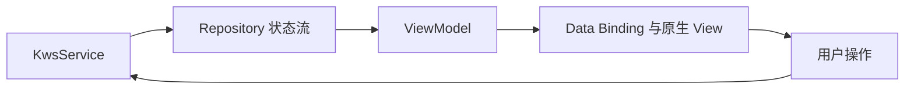

# 技术说明

本文记录当前实现的模块边界、运行规则和已知限制。使用配置见 [项目说明](../项目说明.md)，开发约定见 [贡献指南](../CONTRIBUTING.md)。车控功能仅限吉利星越 L。

## 模块结构

主要代码位于 `automotive/src/main/java/com/spake/brony/doubaoassistant/`。

| 包或模块 | 职责 | 主要入口 |
| --- | --- | --- |
| `ui`、`viewmodel` | 页面、布局、授权、设置和状态呈现 | `MainActivity`、`PermissionActivity`、`KwsViewModel` |
| `ui/overlay` | 后台聊天悬浮窗、拖动和尺寸保存 | `ChatOverlay` |
| `service` | 语音服务生命周期、控制口令与组件协调 | `KwsService` |
| `speech/kws`、`speech/audio` | 本地唤醒、单路采音、音频解码与播放 | `KwsRecognizer`、`MicrophoneRecorder`、`TtsAudioTrackPlayer` |
| `speech/asr`、`speech/tts` | 豆包语音识别与流式合成 | `AsrController`、`DoubaoAsrRecognizer`、`DoubaoTtsPlayer` |
| `speech/network` | 保留 SDK 二进制封包的 WebSocket 传输 | `DoubaoBinaryWsClient` |
| `conversation` | 提交问题、意图筛选、操作分发、打断和回复管理 | `ConversationCoordinator`、`AiOperationExecutor` |
| `data/network` | 方舟 Responses 请求与流式结果解析 | `DoubaoResponsesClient`、`ResponseStreamParser` |
| `data/repository`、`data/local` | 状态、设置、凭证和聊天数据库 | `CredentialStore`、`ChatHistoryRepository`、`ChatHistoryDatabase` |
| `car` | 星越 L 的 ECARX 车控接入 | `GeelyHvacController` |
| `system` 及各控制器 | 应用、导航、电话、音乐、音量与红外 | `SystemOperationController` |
| `information` | 天气、地点和时间查询 | `InformationController` |

`MainLayout.kt` 和 `PermissionLayout.kt` 分别管理两个页面的尺寸适配。它们不处理服务凭证或授权结果。

## 状态与生命周期

页面通过 Repository 接收最新快照，不持有服务实例。StateFlow 用于呈现状态，会合并快速更新；AI 请求、控制指令和播报由业务层直接执行，避免依赖页面订阅触发。

服务管理当前采音、识别、对话和播放任务。切换会话或取消回答后，旧代次的回调不能覆盖新状态。页面重建不重新发送问题，也不自动重播历史。

### 交互规则

- 前台未暂停时可直接聊天；默认退到后台后停止云端聊天，保留本地 KWS。恢复口令可直接开启后台聊天，不自动打开页面。
- 暂停聊天会停止云端 ASR、AI 和 TTS，保留麦克风及本地 KWS；关闭麦克风会停止采音、KWS 和 ASR，当前 AI/TTS 可继续。
- 关麦后不能用语音恢复，必须手动开启。聊天未暂停时，关麦状态提供文字输入。
- 连续聊天模式在识别问题后继续聆听；单次回答模式停止云端识别，等待下一次恢复口令或按钮操作。
- 无人说话计时为 70 秒；等待 AI 或播报期间不累计，回复结束后重新计时。
- “退下/退出”语音口令返回桌面；界面上的退出按钮在确认后停止服务并退出应用，两者行为不同。
- 悬浮聊天依赖已有前台服务及悬浮窗权限；不保证系统杀进程、强制停止或厂商后台限制后的可用性。

## 语音链路

### 音频采集与本地唤醒

只有一条 `AudioRecord` 采集链路：`VOICE_COMMUNICATION`、16 kHz、单声道、PCM16。同一份音频按当前状态用于本地 KWS 和云端 ASR，不启用 SDK 内置录音，不保存录音文件。

本地模型使用 sherpa-onnx；称呼修改只替换关键词流，不重启麦克风或模型。默认称呼为“豆包”，支持 2～3 个汉字；昵称拼音使用离线数据。

| 口令示例 | 行为 |
| --- | --- |
| 你好豆包 | 恢复聊天，播放本地“我在”提示音 |
| 可以说话了豆包 / 说话豆包 / 豆包说话 | 恢复聊天，播放本地“好的”提示音 |
| 闭嘴豆包 / 别说话豆包 | 停止旧回复并暂停聊天 |
| 豆包关闭麦克风 | 关闭采音，保留正在进行的回复 |
| 退下豆包 / 退出豆包 | 返回桌面，按后台聊天设置决定后续状态 |

本地 KWS 优先处理口令，暂停、关麦及退下也有 ASR 确定句兜底。识别要求包含当前助手称呼，多个本地动作按关麦、暂停、退下的顺序匹配。匹配规则可能命中引用或否定句，这是当前实现的已知限制。

### 豆包 ASR 与 TTS

语音 SDK 为 `com.bytedance.speechengine:speechengine_tob:0.0.15.0`，使用 App ID + Access Token 鉴权。模型、资源及音色配置见 [项目说明](../项目说明.md#模型与资源配置)。

ASR 使用 Seed 流式协议，路径为 `/api/v3/sauc/bigmodel_async`，由服务端 1200 ms VAD 判停确认完整语句。SDK 单次语音上限为 60 秒，接收超时为 70 秒；正常结束与接续由当前识别状态管理。

ASR/TTS 共用 `DoubaoBinaryWsClient`，直接发送 SDK 产生的二进制包，避免默认 WebSocket 客户端将控制字节裁剪后误发为文本。SDK 操作不在回调中同步销毁。

TTS 使用双向接口 `/api/v3/tts/bidirection`。模型新增文本逐段送入同一合成会话；收到的 Ogg/Opus 由 `MediaCodec` 解码，再通过 `AudioTrack` 播放，关闭 SDK 内置播放器及音频转储。音频采样率为 48 kHz，语速慢/标准/快分别映射为 -20/0/20。

ASR 发现新的发言时可取消旧 AI 请求和播报；单次回答、关麦及关麦口令候选仍遵循各自规则。音频焦点被抢占时停止播报，保留文字结果。TTS 队列和会话时长有上限，失败时提示，不无限重试。

当前自动打断依赖 ASR 首字结果；系统 AEC 不保证完全排除扬声器回声。唤醒前没有音频缓存，后台唤醒后应等待本地确认音，再说问题。

## AI 与操作执行

普通对话使用方舟 Responses 接口，关闭深度思考，流式生成，输出上限为 2048 token。只发送文字，不发送录音。付费请求不自动重发。

开启 AI 操控后，普通输入先做能力关键词筛选：

1. 未命中关键词，直接进入普通聊天。
2. 命中后，第一轮独立非流式请求判断 `is_operation` 并选择候选意图；请求不带历史，`store=false`，输出上限 512 token。
3. 判定为闲聊时回到普通聊天；判定为操作时，第二轮只附加选中意图的规则和严格 JSON Schema。
4. 程序校验完整操作列表、候选意图、参数和权限，再交给对应模块执行；JSON 不直接显示或朗读。
5. 操作结果汇总为系统消息并播报。未知能力或失败不能声称执行成功。

车控、音量、红外、查询、应用操作分别分组；组间并发，同组按原顺序执行。取消会停止未完成任务，已经发生的设备动作不回滚。关闭 AI 操控后不再开始尚未执行的操作，本地口令仍可用。

`AiOperationExecutor` 仅依赖 `CarOperations`、`SystemOperations`、`ApiOperations` 三个接口。具体控制器由服务创建并管理生命周期。车控参考仓库与车型范围见 [项目说明](../项目说明.md#车控参考与适用范围)。

## 数据存储与隐私

### 服务凭证

`CredentialStore` 保存三项凭证，以 AES-256-GCM 加密后写入私有 SharedPreferences。密钥由 Android Keystore 管理，每次加密使用新 IV；凭证不参与云备份和设备迁移。

凭证保存必须取得同步落盘结果；失败时恢复原内存值，不能继续进入聊天。密文损坏或密钥失效时返回空配置，要求重新配置，不回退使用 APK 内的默认凭证。格式校验不等于云端鉴权成功。

### 聊天数据库

数据库为应用私有的 `chat_history.db`，使用 Room，当前版本为 **2**。包含 `topics` 和 `messages` 两张表；版本 1 → 2 的迁移增加 `json_message` 字段。仍保留破坏性回退，遇到没有迁移路径的不匹配版本可能清空重建。

- 写入使用容量为 64 的有界队列，串行访问；服务关闭时排空已经提交的任务。
- 流式回复更新同一消息，通常每约 500 ms 保存一次，结束或取消时补交最后内容。
- 页面恢复当前话题最近 40 条消息；调试记录页通过独立只读连接按每页 50 条读取。
- 只有成功完成的普通 AI 回复保存 `previous_response_id`；操作回复和本地口令不作为聊天上下文。
- 上下文 ID 从数据库读取，并等待排队写入完成，避免读取旧状态。
- 手动清除记录使用事务删除旧消息与话题，再创建新话题。距最后消息超过 60 小时进入主页时，也会按既有规则清理。

数据库正文是本地明文，受应用沙箱保护，并排除系统备份；卸载或清除应用数据会删除记录。本地删除不等于删除方舟云端保存的数据。应用不保存录音文件，日志对凭证脱敏；强制断电仍可能丢失尚未落盘的最后一段文字。

## 外部能力限制

- **星越 L 车控**：依赖 ECARX 接口、固件权限和硬件能力；属性支持、写入及结果确认均由控制器处理。遮阳帘映射仍需要实车验证。
- **导航与电话**：依赖已安装的接收应用和系统权限；按姓名呼叫还需要本机通讯录。
- **音乐**：使用 QQ 音乐入口。按歌名点播当前实际打开搜索结果，未接入自动选曲；唤起成功不等于已收到播放结果。
- **天气**：当前限定中国，最多查询未来七天；默认查询当前位置时按需申请定位，不申请后台持续定位。
- **时间**：依赖设备时钟；国外城市可能联网解析时区，多时区国家需要明确城市。
- **红外**：当前为 Sony12、地址 1、40 kHz 的电视电源码，不通用于任意电视；发送成功只表示指令已发送。

## 第三方资源

- sherpa-onnx Android SDK：1.13.8，本地依赖位于 `automotive/libs/`。
- KWS 模型：`sherpa-onnx-kws-zipformer-zh-en-3M-2025-12-20`，使用 chunk-8 模型。
- 模型卡与 Apache-2.0 许可证位于 [KWS 资源目录](../automotive/src/main/assets/kws/)。
- 昵称拼音数据来源及 MIT 许可证见同目录下 `pinyin-SOURCE.md` 和 `pinyin-LICENSE.txt`。
- 天气与地点来源为 [Open-Meteo](https://open-meteo.com/) 和 [GeoNames](https://www.geonames.org/)，数据来源和使用条款应在分发时保留。

仓库记录的下载校验值如下：

| 文件 | SHA-256 |
| --- | --- |
| `sherpa-onnx-1.13.8.aar` | `633c24321e06b1fe79feafa03ea16cbc0f8a286641e2da3559bac91bdb13bd96` |
| `sherpa-onnx-kws-zipformer-zh-en-3M-2025-12-20.tar.bz2` | `68447f4fbc67e70eee3a93961f36e81e98f47aef73ce7e7ca00885c6cd3616a6` |

## 验证范围

编译任务不验证云端鉴权、实际语音效果、设备权限和车辆动作。语音打断、回声、长时间运行、前后台切换和各项车控需由使用者在目标星越 L 车机上验证。测试执行约定见 [AGENTS.md](../AGENTS.md)。
