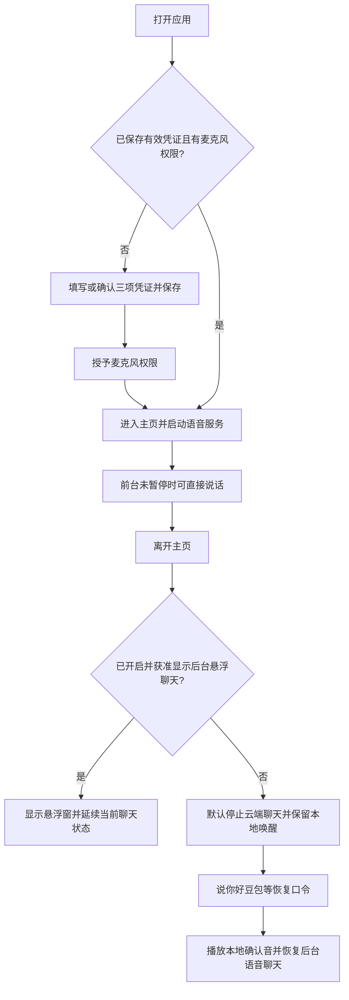
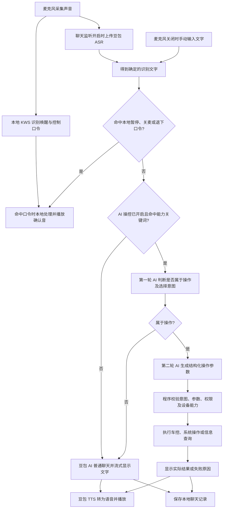

# DoubaoAssistant 项目说明

DoubaoAssistant 是运行在 Android 车机上的中文语音助手。它把本地唤醒、豆包语音识别、豆包 AI 对话、语音播报和车机控制串在一起，让用户通过说话聊天、查询信息或操作设备。

**车型限制：本项目的车机控制功能仅限吉利星越 L 使用，不支持其他车型。** 空调、座椅、车窗、天窗和遮阳帘等车控功能均受此限制。

本文面向使用者，说明项目功能、运行流程、服务配置与构建方式。Key 获取入口核对日期：2026-10-30。技术实现见 [技术说明](docs/ARCHITECTURE.md)，开发约定见 [贡献指南](CONTRIBUTING.md)。

## 目录

- [项目功能](#项目功能)
- [运行流程](#运行流程)
- [凭证与服务配置](#凭证与服务配置)
- [构建版本](#构建版本)
- [车控参考与适用范围](#车控参考与适用范围)

## 项目功能

| 功能 | 说明 |
| --- | --- |
| 本地唤醒与控制口令 | 使用 sherpa-onnx 在设备本地识别唤醒、暂停、关麦和退下等口令；支持修改助手称呼，默认称呼为“豆包” |
| 语音转文字（ASR） | 将用户说的话通过豆包流式语音识别转为文字，并显示识别中的字幕 |
| AI 聊天 | 使用豆包模型流式回复，支持同一话题的上下文，以及极简、简单、详细三种回复习惯 |
| 文字转语音（TTS） | 把 AI 回复或操作结果转为声音，边生成边播报，支持调整语速；新问题可以打断旧回复 |
| 车机控制（仅限吉利星越 L） | 已接入空调总开关、AC 制冷、AUTO、温度、风速、内外循环、后窗加热、座椅加热/通风，以及车窗、天窗、遮阳帘开度控制 |
| 系统与应用操作 | 打开已安装应用、发起地图导航、拨打电话、音乐控制和音量调节；实际支持范围取决于系统权限和目标应用 |
| 信息查询 | 查询中国城市的当前天气及未来七天预报，查询时间、日期、星期和指定地区时间 |
| 文字输入 | 关闭麦克风且聊天未暂停时，可以输入文字，继续使用同一套聊天与操作流程 |
| 后台聊天 | 支持后台语音唤醒；开启并授权后，可显示详细、精简或极简样式的悬浮窗 |
| 本地记录与设置 | 保存聊天文字和上下文 ID，支持清除记录；支持浅深色、左右布局、字幕及调试信息设置 |
| 红外电视电源 | 设备具备红外硬件时可发送电视开关信号；当前内置 Sony12 编码，需要与实际电视匹配 |

本地唤醒不需要云端 Key；ASR、AI 和 TTS 需要联网及对应服务额度。天气使用 Open-Meteo，当前实现不要求用户配置天气 Key。

### 运行条件

- Android 9（API 28）及以上，当前只打包 `arm64-v8a`，需要能运行 ARM64 应用的车机。
- 当前清单要求 `android.hardware.type.automotive`，面向原生 Android 车机，不能直接当作普通手机应用或 Android Auto 投屏应用使用。
- 车控仅限吉利星越 L，依赖其 ECARX 系统接口、设备能力与固件权限；其他车型不在支持范围内。
- 麦克风权限是语音入口的必要条件；悬浮窗、定位、电话和通讯录等权限按使用场景申请。

### CPU 架构兼容性

“当前 APK 需要 ARM64”描述的是本项目的构建配置，不代表 sherpa-onnx 只支持 ARM64。当前本地依赖与打包范围如下：

| 组件 | 版本 | 本地库包含的 CPU 架构 |
| --- | --- | --- |
| sherpa-onnx | 1.13.8 | ARM32（`armeabi-v7a`）、ARM64（`arm64-v8a`）、`x86`、`x86_64` |
| 豆包语音 SDK | 0.0.15.0 | ARM32（`armeabi-v7a`）、ARM64（`arm64-v8a`） |
| 当前项目 APK | `personal` / `general` | 仅 ARM64（`arm64-v8a`） |

本地 AAR 仍保留上述架构的原生库。项目在 `automotive/build.gradle.kts` 中通过 `abiFilters += "arm64-v8a"` 只选择 ARM64 参与打包，没有从原始 AAR 中删除其他架构。

两项依赖均包含 ARM32 原生库，因此具备后续调整为 ARM32 构建的基础，但当前 APK 尚不支持仅能运行 ARM32 应用的设备，适配后仍需在目标设备验证。豆包语音 SDK 不包含 x86 / x86_64 原生库，仅取消打包过滤不能使完整语音链路支持这两种架构。

## 运行流程

### 首次启动与后台唤醒



以上语音流程以麦克风开启为前提。关麦后本地唤醒也会停止，必须手动重开麦克风。后台唤醒不会自动打开主页面；关闭应用进程后需要手动打开应用。

### 从一句话到回答或操作



麦克风只有一路，本地 KWS 与云端 ASR 按状态共用采集的音频。图中省略了取消、异常及超时分支；发生错误会提示，不会把失败当作操作成功。AI 负责识别意图与提取参数，具体操作由程序调用接口完成。关闭“AI操控功能”后，普通问题直接聊天，本地暂停、关麦等口令仍独立生效。

## 凭证与服务配置

当前一共填写三项配置，ASR 和 TTS 共用一组语音凭证，AI 使用独立凭证。

| 配置字段 | 应用内名称 | 用途 | 获取位置 |
| --- | --- | --- | --- |
| `appId` | App ID | 标识使用语音服务的应用 | 豆包语音旧版控制台 |
| `accessToken` | Access Token | ASR 语音识别和 TTS 语音合成鉴权 | 与 App ID 对应的语音应用 |
| `arkApiKey` | Ark API Key | 豆包 AI 聊天、操作意图判断和参数生成 | 火山方舟控制台 |

**语音服务使用 App ID + Access Token，AI 服务使用独立的 Ark API Key，三项均需配置。** 当前不使用语音 API Key、Secret Key 或火山账号的 IAM Access Key / Secret Key。

### 获取语音服务凭证

1. 登录火山引擎，进入[豆包语音旧版应用管理](https://console.volcengine.com/speech/app)，选择或创建要使用的语音应用。
2. 在旧版控制台左侧“API服务中心”选择对应语音模型和应用，查看 **App ID** 与 **Access Token**。
3. 在同一个语音应用下开通本项目使用的语音识别和语音合成服务，保证两项服务都有可用额度或计费权限。
4. 将这组 App ID、Access Token 分别填入 `appId`、`accessToken`。不要把不同应用的凭证混在一起。

官方说明见[豆包语音控制台指引中的“旧版控制台指引”](https://docs.volcengine.com/docs/doubao-voice/console-guidance?lang=zh)。新版语音控制台主要提供 API Key；当前项目使用旧版的 App ID + Access Token，需要进入对应旧版入口获取。

### 获取 AI 服务凭证

1. 登录[火山方舟 API Key 管理](https://ark.volcengine.com/region:cn-beijing/apiKey)，切换到准备使用的资源项目。
2. 创建 API Key，复制后填入 `arkApiKey`；如果限制了 Key 权限，需要允许访问本项目使用的模型。
3. 在[模型开通管理](https://ark.volcengine.com/region:cn-beijing/openManagement)确认已开通对应模型，并有可用额度或计费权限。

操作说明见[火山方舟快速入门](https://docs.volcengine.com/docs/ark/quick-start?lang=zh)和[API Key 管理](https://docs.volcengine.com/docs/ark/manage-api-keys?lang=zh)。这里创建的是 API 调用凭证，登录豆包 App 本身不能替代它。

### 模型与资源配置

| 服务 | 当前配置 | 配置位置 |
| --- | --- | --- |
| 流式语音识别 ASR | `volc.seedasr.sauc.duration` | `automotive/build.gradle.kts` 中的 `DOUBAO_ASR_RESOURCE_ID` |
| 双向流式语音合成 TTS | `seed-tts-2.0` | 同文件中的 `DOUBAO_TTS_RESOURCE_ID` |
| TTS 音色 | `zh_female_vv_uranus_bigtts` | 同文件中的 `DOUBAO_TTS_SPEAKER` |
| AI 对话模型 | `doubao-seed-2-0-mini-260428` | 同文件中的 `DOUBAO_CHAT_MODEL` |

这些 ID 是当前代码的配置值，不是需要保密的 Key。模型及资源要与控制台开通项匹配；换模型或音色时也要同步调整代码配置。

### 配置文件与应用内保存

自用版构建前，将根目录的 `doubao-asr.properties.example` 复制为 `doubao-asr.properties`，填写自己的值：

```properties
appId=你的语音AppID
accessToken=你的语音AccessToken
arkApiKey=你的方舟APIKey
```

模板 `.example` 保持空值，可以提交 Git；真实配置 `doubao-asr.properties` 已被 Git 忽略。构建只读取真实配置文件。

通用版安装后在应用配置页填写上述三项；自用版会预填构建时的本机配置，首次启动仍需要确认保存。保存后的凭证以 AES-GCM 加密存入应用私有空间，加密密钥由 Android Keystore 管理。后续可在“设置 → 服务凭证 → 修改”中更换。

不要在文档、代码、截图或 Git 中放真实凭证。**自用版 APK 内含构建时嵌入的凭证，不适合公开分发；代码混淆不能消除这项风险。**

## 构建版本

项目有两个发行版本（Product Flavor），功能代码相同，主要区别是是否在安装包中嵌入开发者的凭证：

| 对比项 | `personal` 自用版 | `general` 通用版 |
| --- | --- | --- |
| 适用对象 | 自己使用 | 分发给其他人，由对方配置凭证 |
| 构建时读取本机凭证 | 读取 `doubao-asr.properties` | 不嵌入本机凭证，默认值为空 |
| 首次配置页 | 预填本机配置，仍需确认保存 | 空白，由使用者自行填写 |
| 是否含开发者 Key | 本机有配置时会含有 | 不嵌入开发者 Key |
| 应用 ID | `com.spake.brony.doubaoassistant` | `com.spake.brony.doubaoassistant.general` |
| 安装关系 | 可与通用版同时安装 | 可与自用版同时安装，数据互不共享 |

每个版本还分为 `debug` 和 `release`，组合后有四种 Build Variant：

| Build Variant | 含义 |
| --- | --- |
| `personalDebug` | 自用调试版；项目默认选择 |
| `personalRelease` | 自用发布构建；启用代码混淆和资源压缩，仍然含本机凭证 |
| `generalDebug` | 通用调试版；不嵌入开发者凭证 |
| `generalRelease` | 通用发布构建；启用代码混淆和资源压缩，适合签名后分发 |

Android Studio 在 **Build Variants** 面板选择所需组合。也可以使用以下命令分别打包，命令不会执行测试：

```sh
# 自用调试版
./gradlew :automotive:assemblePersonalDebug

# 通用调试版
./gradlew :automotive:assembleGeneralDebug

# 自用发布构建
./gradlew :automotive:assemblePersonalRelease

# 通用发布构建
./gradlew :automotive:assembleGeneralRelease
```

默认 APK 位于 `automotive/build/outputs/apk/<personal或general>/<debug或release>/`。命令行 Release 当前未配置签名，默认产物为 `-unsigned.apk`，需要签名后安装；也可在 Android Studio 的 **Generate Signed App Bundle / APK** 中选择版本并签名。

`personal/general` 决定凭证预填方式；`debug/release` 决定调试或发布构建方式。选择 Release 不会自动去掉自用版的 Key。两种发行版本当前均只打包 ARM64。

## 车控参考与适用范围

**本项目车控适用车型仅为吉利星越 L。** 参考仓库不代表本项目支持其他车型。

车机控制主要参考 [Schum-io/Geely_Monjaro_oneOS_Hvac](https://github.com/Schum-io/Geely_Monjaro_oneOS_Hvac)，原仓库是面向 Geely Monjaro REST 1 的 oneOS HVAC 扩展项目。

本项目的 `automotive/src/main/java/com/spake/brony/doubaoassistant/car/GeelyHvacController.kt` 已注明该来源，参考了其中的 `GlyCarImpl`、`MainViewModel`、`GlyCarPropertyIds` 及相关区域定义，包括：

- ECARX 车机 API 的创建、连接就绪监听和释放方式。
- 空调、温度、风速、内外循环、座椅等属性 ID、参数编码与区域映射。
- 车窗、天窗及相关开度属性的调用依据。

当前项目由自己的 Kotlin 控制器通过反射访问车机系统提供的 `com.ecarx.xui.adaptapi` 接口，没有把原项目作为 Gradle 依赖，也没有把原仓库的 Magisk 模块安装流程作为本项目运行前提。

实际调用路径是：

```text
用户说出操作要求
  → 豆包 AI 提取意图和参数
  → AiOperationExecutor 校验并分发
  → GeelyHvacController
  → 车机系统 ECARX API
  → 读取支持能力、下发操作并确认结果
```

即使是星越 L，也需要对应固件提供接口、授予权限并支持相关硬件。代码已接入相应能力，不代表所有年款、配置和固件均已验证可用；例如遮阳帘区域映射仍需要实车确认。不支持的功能或被拒绝的权限会返回失败，需要在目标星越 L 车机上逐项验证。
